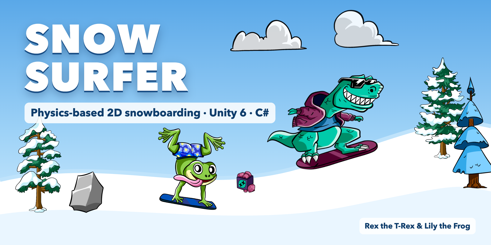

# Unity Snow Surfer



A physics-based 2D snowboarding game built with Unity as part of a structured 7-month game development learning journey.
Targeting a junior Unity Developer position.

Pick your rider, carve down the slope, land flips for points and grab timed power-ups, without wiping out.

> The cover image is composed from the game's own sprites; it is not an in-game screenshot.

## 🎮 Controls

### Keyboard
| Key | Action |
|-----|--------|
| A / ← | Rotate (counter-clockwise) |
| D / → | Rotate (clockwise) |
| W / ↑ | Boost (hold) |

### Gamepad
| Input | Action |
|-------|--------|
| Left stick ← / → | Rotate |
| Left stick ↑ | Boost (hold) |

## 🏁 Goal / Fail Conditions

- **Goal:** Ride to the finish line; a finish particle burst plays and the run restarts
- **Fail:** The rider's crash trigger touches the slope (a wipe-out) → crash effect, controls disabled, run restarts after 1 second
- **Score:** Every full rotation (flip) adds **+20** points

## ✅ Features

### Character Select
- Choose between **Rex the T-Rex** and **Lily the Frog** before the run starts
- The game stays paused (`Time.timeScale = 0`) until a rider is chosen

### Riding Physics
- Rotation via `Rigidbody2D` torque, giving air control for flips
- Slope speed driven by `SurfaceEffector2D` (base speed vs. boost speed)
- Flip detection by accumulating rotation with `Mathf.DeltaAngle` (no false counts across the 0°/360° wrap)

### Power-ups (ScriptableObject driven)
| Power-up | Effect | Duration |
|----------|--------|----------|
| Short Speed | +10 slope speed (base & boost) | 2 s |
| Long Speed | +10 slope speed (base & boost) | 10 s |
| Short Torque | +15 rotation torque | 3 s |

- Each power-up is a `PowerupSO` asset (type · value · duration), so new power-ups are data, not code
- Pickups stack; the power-up particle effect stays on until the last active one expires

### Feedback
- Snow trail particles while the board touches the slope
- Crash, finish and power-up particle effects
- Live score display (TextMeshPro)
- Smooth follow camera (Cinemachine)

## 🛠️ Technical Details

- **Engine:** Unity 6.4 (`6000.4.4f1`)
- **Language:** C#
- **Rendering:** Universal Render Pipeline (2D)
- **Input:** Unity Input System (keyboard + gamepad)
- **Camera:** Cinemachine 3
- **Physics:** Rigidbody2D · SurfaceEffector2D · trigger-based crash / finish / pickup detection

## 📁 Project Structure

```
Assets/
├── Scripts/
│   ├── PlayerController.cs    # rotation, boost, flip scoring, power-up effects
│   ├── CrashDetector.cs       # head-on-snow crash → restart
│   ├── FinishLine.cs          # finish effect → restart
│   ├── PowerupManager.cs      # pickup + countdown, applies/removes PowerupSO
│   ├── PowerupSO.cs           # ScriptableObject: type · value · duration
│   ├── ScoreManager.cs        # score + UI text
│   ├── SnowTrail.cs           # snow particles on slope contact
│   └── CharSelectManager.cs   # rider selection, starts the run
├── PowerUp/                   # ShortSpeed · LongSpeed · ShortTorque assets
├── Scenes/SampleScene.unity   # the level
└── Sprites/                   # riders, trees, rocks, clouds, slope tiles
```

## ▶️ How to Run

1. Install **Unity 6.4 (6000.4.4f1)** via Unity Hub
2. Clone the repository and open the folder in Unity Hub (**Add project from disk**)
3. Open `Assets/Scenes/SampleScene.unity` and press **Play**
